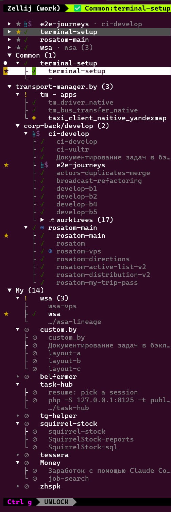

# zellij-tree-tabs

A tree sidebar for [Zellij](https://zellij.dev): tabs grouped into a collapsible tree, each tab's panes under it, favorites on top, a keyboard mode, and Claude Code session state (waiting, working, done, unread) on every pane, tab and folded group.



Install: [Build & install](#build--install). Bugs and ideas: [issues](https://github.com/likemusic/zellij-tree-tabs/issues), questions: [discussions](https://github.com/likemusic/zellij-tree-tabs/discussions).

## What it adds to zellij-vtabs

`zellij-tree-tabs` grew out of [otezz/zellij-vtabs](https://github.com/otezz/zellij-vtabs), which its author keeps as a personal tool. It is used daily with dozens of Claude Code sessions in one Zellij session (Zellij 0.45, Windows Terminal + WSL). The sections after this one describe the base plugin; on top of it:

- **Pane list under each tab** with two or more panes, titles refreshed every 2 s (Claude's own session titles show up there), stacked panes included (Zellij reports a stack's collapsed panes as suppressed); `show_single_pane "true"` lists a lone pane too.
- **Per-pane state icons**: the same `waiting` / `working` / `completed` pipes mark the pane row, not only the tab. Marks are the session's state, not unread cues: looking at a tab or pane does not clear them, only the next signal does (`clear-working` on SessionEnd clears all).
- **State markers as prefixes** (`⚙ name` instead of `name ⚙`); old suffix markers are still recognized.
- **Keyboard mode** (`MessagePlugin … { name "vtabs-focus"; }`, e.g. bound to `Alt+w`): arrows / `j` `k` browse tabs with a live preview and step onto pane rows (the pane frame is highlighted), Enter stays/focuses, Esc returns. Needs the `MessageAndLaunchOtherPlugins` permission for the hand-over between per-tab instances.
- **Status view** (`v` in keyboard mode, `м` on a Russian layout; `default_view "status"` to start in it): every session (terminal pane) listed under Waiting / Working / Done / Idle, most urgent first, labelled with its title and its tab. The choice is saved, so every tab's sidebar shows the same view; reordering is done in the project view.
- **Background-work column**: a finished turn (`✓`) that still has shell commands running in the background or monitors armed reads apart from an idle one: `$` (shells) and `◉` (monitors) after the state icon, summed over a tab's panes. `shell/vtabs-bg.sh` (started by `vtabs-work.sh`, one per pane) finds them among the Claude process's children every 2 s and sends `zellij-vtabs::background::<pane>` with the payload `"<shells> <monitors>"`. While a turn runs, its own foreground command counts as a shell too. The two cells are always reserved, so names never shift when work starts or ends.
- **Tab state rolls up its panes**: a tab with several sessions shows the most urgent pane state (waiting > working > done), not the last signal.
- **Click goes there**: a click on a tab row shows that tab, a click on a pane row focuses that pane (in any tab; a pane collapsed in a stack unfolds). The clicked sidebar does it itself, so it works whatever the other tabs' sidebars know. A click on a group's `▼`/`▶` folds it; a click on its name selects it and enters keyboard mode, where `←`/`→` act on it. Keyboard mode (browse with the arrows, Enter, Esc) is also entered by its key binding.
- **Click log**: every click is logged to the Zellij log as `VTABS click ...` (where from, which tab and pane); `shell/vtabs-watch [session] [--all]` follows the log and prints a `MISS` line for a click after which the clicked tab or pane is not the focused one.
- **Width and collapse** (keyboard mode, the same keys on any keyboard layout): `-` narrower, `=` wider, `0` collapses the sidebar to its narrowest, drawing only state icons, and expands it back. Each tab keeps its own width, also one set by dragging the border with the mouse: Zellij resizes a pane in steps of 5% of the tab and drops a hidden tab's resize, so a width shared by all tabs could not be matched and jumped on every tab switch. Needs the sidebar's `size` in the layout as a percentage (e.g. `size="15%"`): Zellij does not resize a fixed-size pane.
- **Selection follows focus**: the highlighted row is the focused pane's row when the active tab lists its panes, also after Alt+arrows and clicks.
- **Pinned sidebar** (`pinned`, on by default): focus never lands on the sidebar by accident; `pinned "false"` restores upstream behavior.
- **Move a tab to another session** (`m` in keyboard mode, `ь` on a Russian layout, then the session's digit): Zellij cannot hand live processes between session servers, so `shell/zellij-move-tab` (on `PATH`, or set `move_tab_command`) cuts the tab out of `dump-layout`, closes it in the source and opens the layout as a new tab in the target. Claude panes started through the claude-zellij wrapper come back in the same conversation through the resurrection hook; shells keep only their working directory. If the target refuses the layout, the tab is reopened in the source. `zellij-move-tab <from> <tab-id> <to> --dry-run` prints the layout. Needs the `RunCommands` permission; the log is `/tmp/zellij-move-tab.log`.
- **Collapsed stacked panes**: choosing one in keyboard mode expands it in its stack.
- **Auto-named one-pane tabs** follow their pane title (for a command line just the program name) until renamed by hand.
- **Favorites** (`f` in keyboard mode, `а` on a Russian layout, or a right click on a pane row): favorite panes are listed on top, above the scrolled tree, under a `Favorites` header that folds them, each with its tab's name and how many other panes of the tab wait for an answer or finished unread; a ★ marks them in the tree too. The `▸` before a favorite's ★ (click, or `→`/`←` in keyboard mode) unfolds the tab's other panes under it; they are folded by default, so a click doesn't make the list jump. `Shift+↑`/`Shift+↓` (or `K`/`J`) on a favorite moves it among the favorites, so the most important ones can sit on top. When the selection is on a pane listed twice, its other row gets a soft bar.
- **Pane count**: a tab with several panes shows how many next to its `▾`/`▸` (`▾3`), kept up to date; a favorite and a worktree list count what they fold the same way, so the number need not live in the tab's name.
- **Waiting section**: below the favorites, a `Waiting` header lists every session that waits for an answer, with its title and tab, so it can be reached in one click wherever its tab is folded or scrolled away. It is left out while nothing waits, and folds like a group.
- **Auto-close**: a tab where only the sidebar is left (the terminal exited) closes itself.

The plugin file, pipe names and config keys keep the upstream name `zellij-vtabs` (`zellij-vtabs.wasm`, `zellij-vtabs::<signal>::<pane>`), so existing configs keep working. Setup is the same as upstream below; [Claude Code integration](#claude-code-integration) lists the hooks, including the fork's `PostToolUse` and compact hooks.


## What it does

Zellij has no native vertical tabs. This plugin renders a left sidebar showing tabs as a
**collapsible tree grouped by name prefix**, so many tabs stay organized at a glance.

Groups (`▼`/`▶`) collapse and expand; `◆` (yellow) marks a tab needing input, `✓` (green) a
finished one, and `●` marks the active tab. A `✓` is bright and bold while unread — the
session finished its turn (or asked something) while you were in another pane, like
Zellij's `[!]` — and dim once you have been in that pane. A `zellij-vtabs::read::<pane_id>`
pipe marks a pane read (used when restoring marks after a plugin reload).

- **Grouping** — a tab named `group:label` goes under group **group** with label **label**;
  a tab with no `:` lands in **General**. (First `:` wins.)
- **Collapse / expand** groups (`▶`/`▼`).
- **Reorder groups and tabs** — `Shift+J`/`Shift+K` (or `Shift+↓`/`Shift+↑`) move the
  selected row: a group header moves the whole group, a tab moves within its group. Tab
  moves are *virtual* (display-order only — the plugin API can't move real tabs): a group
  follows Zellij's native tab positions until you explicitly reorder in it, after which the
  saved order wins for that group.
- **Persistent state** — group order, tab order, and collapse state survive session
  restarts and stay in sync across every tab's sidebar (stored per session in the plugin's
  cache dir).
- **Rename inline** — `r` opens an inline editor (`Enter` commits, `Esc` cancels): on a
  group header it renames the group (every member tab is re-prefixed, saved state
  follows); on a tab row it renames the tab's label, keeping its group.
- **Auto-grouping (opt-in)** — a small shell script pipes each pane's starting directory
  (+ git facts) to the plugin, which auto-names still-default tabs (`repo:branch`,
  `repo:worktree`, …) by configurable rules. Manual names always win. See below.
- **Key hints** — while the sidebar has the keys, its bottom lists them (Zellij's status bar is another plugin and can't).
- **Navigate** with `j`/`k`/arrows, `Enter`/`Space` to switch tab or toggle a group. As in a file tree, `←`/`h` folds an open group or goes up to the group (a pane row: to its tab), `→`/`l` unfolds a folded group or steps into an open one.
- **Mouse**: left-click to switch/toggle, scroll to move the selection.
- **Active tab** marked with `●`; the selection highlight follows it.
- **Attention icons** — `◆` (yellow, needs input) and `✓` (green, done), appearing on the
  tab and **rolling up to a collapsed group's header**. Cleared automatically when you focus
  the tab. Wired to Claude Code's `Notification`/`Stop` hooks.
- **Working spinner** — an animated cyan spinner while Claude is running in a tab (wired
  to the `UserPromptSubmit` hook). Unlike the attention icons it shows on the active tab
  too and is *not* cleared by focusing — it ends when Claude needs input, finishes, or
  exits (`SessionEnd`). Rolls up to collapsed group headers (waiting > working > done).

## Requirements

- **Zellij ≥ the `zellij-tile` version the wasm was built with** — release builds use
  `0.44.2`, and the prebuilt wasm is verified working on Zellij **0.43.1, 0.44.2, and
  0.44.3**, and used daily on **0.45.1** (the protobuf plugin API tolerates version skew in both directions better than
  Zellij's error messages suggest; a plugin built against a *newer* `zellij-tile` than the
  running Zellij is the combination that reliably fails).
- **Building from source:** Rust + `cargo` with the `wasm32-wasip1` target
  (`rustup target add wasm32-wasip1`), and keep the `zellij-tile` pin **at or below** your
  Zellij version — don't use a caret/range requirement, Cargo resolves those upward.

## Quick try (zero install)

Zellij can load the plugin straight from the release URL — no download, no Rust. Save
this as `try-vtabs.kdl`:

```kdl
layout {
    pane split_direction="vertical" {
        pane size=28 borderless=true {
            plugin location="https://github.com/likemusic/zellij-tree-tabs/releases/latest/download/zellij-vtabs.wasm"
        }
        pane
    }
    pane size=1 borderless=true {
        plugin location="zellij:status-bar"
    }
}
```

Pre-seed the permissions in `~/.cache/zellij/permissions.kdl` (the in-pane grant prompt
doesn't render usably in a 28-column sidebar):

```kdl
"https://github.com/likemusic/zellij-tree-tabs/releases/latest/download/zellij-vtabs.wasm" {
    ReadApplicationState
    ChangeApplicationState
    ReadCliPipes
    MessageAndLaunchOtherPlugins
    RunCommands
}
```

Then: `zellij --new-session-with-layout ./try-vtabs.kdl`. Zellij caches the download, so
this also survives offline use. Name a couple of tabs `group:label` and you have the tree.

## Build & install

```bash
cargo build --release --target wasm32-wasip1
cp target/wasm32-wasip1/release/zellij-vtabs.wasm ~/.config/zellij/plugins/zellij-vtabs.wasm
```

Or skip the Rust toolchain and grab the prebuilt `zellij-vtabs.wasm` from the
[latest release](https://github.com/likemusic/zellij-tree-tabs/releases/latest):

```bash
curl -Lo ~/.config/zellij/plugins/zellij-vtabs.wasm \
  https://github.com/likemusic/zellij-tree-tabs/releases/latest/download/zellij-vtabs.wasm
```

Pre-seed the plugin's permissions (Zellij's in-pane grant prompt doesn't render usably in a
narrow sidebar), in `~/.cache/zellij/permissions.kdl`. Note Zellij keys this by the **resolved
absolute** path, so use your real home dir here (not `~`):

```kdl
"/home/<you>/.config/zellij/plugins/zellij-vtabs.wasm" {
    ReadApplicationState
    ChangeApplicationState
    ReadCliPipes
    MessageAndLaunchOtherPlugins
    RunCommands
}
```

Use the layout in `layouts/vtabs.kdl` (also copied to `~/.config/zellij/layouts/vtabs.kdl`),
and set it as the default in `~/.config/zellij/config.kdl`:

```kdl
default_layout "vtabs"
```

and load the background instance that keeps the state for every tab's sidebar (see [One brain, a screen per tab](#one-brain-a-screen-per-tab)), with the same absolute path:

```kdl
load_plugins {
    "file:/home/<you>/.config/zellij/plugins/zellij-vtabs.wasm" {
        role "brain"
    }
}
```

Fast dev loop (code-only changes — layout/config changes still need a fresh session):

```bash
cargo build --release --target wasm32-wasip1 \
  && cp target/wasm32-wasip1/release/zellij-vtabs.wasm ~/.config/zellij/plugins/zellij-vtabs.wasm
zellij action start-or-reload-plugin file:~/.config/zellij/plugins/zellij-vtabs.wasm
```

## Claude Code integration

The attention icons and working spinner are driven by Claude Code hooks. Rather than each
hook piping a fixed signal, they call `shell/vtabs-work.sh` with an event name; the script
keeps a per-pane count of the main-agent turn plus outstanding subagents and derives the
right signal — so the spinner stays lit for the *whole* task, not just the main agent's
first turn. Install it and wire the hooks:

```bash
cp shell/vtabs-work.sh shell/vtabs-bg.sh ~/.config/zellij/ && chmod +x ~/.config/zellij/vtabs-work.sh ~/.config/zellij/vtabs-bg.sh
```

```json
{
  "hooks": {
    "UserPromptSubmit": [{ "hooks": [{ "type": "command", "timeout": 3,
      "command": "(~/.config/zellij/vtabs-work.sh prompt >/dev/null 2>&1 &)" }] }],
    "SubagentStart": [{ "hooks": [{ "type": "command", "timeout": 3,
      "command": "(~/.config/zellij/vtabs-work.sh subagent-start >/dev/null 2>&1 &)" }] }],
    "SubagentStop": [{ "hooks": [{ "type": "command", "timeout": 3,
      "command": "(~/.config/zellij/vtabs-work.sh subagent-stop >/dev/null 2>&1 &)" }] }],
    "Notification": [{ "hooks": [{ "type": "command", "timeout": 3,
      "command": "(~/.config/zellij/vtabs-work.sh notify >/dev/null 2>&1 &)" }] }],
    "Stop": [{ "hooks": [{ "type": "command", "timeout": 3,
      "command": "(~/.config/zellij/vtabs-work.sh stop >/dev/null 2>&1 &)" }] }],
    "SessionEnd": [{ "hooks": [{ "type": "command", "timeout": 3,
      "command": "(~/.config/zellij/vtabs-work.sh end >/dev/null 2>&1 &)" }] }],
    "PostToolUse": [{ "hooks": [{ "type": "command", "timeout": 3,
      "command": "(~/.config/zellij/vtabs-work.sh tool >/dev/null 2>&1 &)" }] }],
    "PreCompact": [{ "matcher": "manual", "hooks": [{ "type": "command", "timeout": 3,
      "command": "(~/.config/zellij/vtabs-work.sh prompt >/dev/null 2>&1 &)" }] }],
    "PostCompact": [{ "matcher": "manual", "hooks": [{ "type": "command", "timeout": 3,
      "command": "(~/.config/zellij/vtabs-work.sh stop >/dev/null 2>&1 &)" }] }]
  }
}
```

- `UserPromptSubmit` (new turn) → start fresh, animated spinner on that tab
- `SubagentStart` / `SubagentStop` → adjust the outstanding-subagent count (spinner stays lit)
- `Notification` (needs input) → `◆` on that tab
- `Stop` (main-agent turn ended) → `✓` **only if no subagents are still outstanding**,
  otherwise the spinner keeps running — this is the whole reason for the counter: `Stop`
  fires once per *main-agent* turn, so without it the spinner would clear while background
  subagents are still working
- `SessionEnd` (Claude exits) → clears any leftover spinner and the pane's count
- `PostToolUse` → after a `Notification` pause (e.g. an answered permission prompt) the next tool call relights the spinner once; otherwise it sends nothing, so it is cheap on every tool call
- `SubagentStop` with nothing outstanding and the turn over sends nothing: Claude Code also fires it for its internal agents, with no `SubagentStart` and often after `Stop`, which used to relight the spinner for good
- `PostToolUse`, `Stop`, `UserPromptSubmit` also start the pane's background-work watcher (`vtabs-bg.sh`, next to `vtabs-work.sh`) if it is not running
- `PreCompact` / `PostCompact` (manual `/compact`) → spinner while compacting, `✓` when done
- Focusing the tab clears `◆`/`✓`; the spinner survives focus and ends via the hooks above

The script also plays a freedesktop sound on exactly those two real events — `complete`
when the whole task finishes and `message-new-instant` when it needs input — gated by the
same counter, so you get one chime per task rather than one per main-agent turn or subagent.
It falls back `canberra-gtk-play` → `pw-play` → silent, so it's a no-op where neither exists.
Delete the `sound=` / playback lines in `vtabs-work.sh` to turn it off.

Why the script (rather than a fixed pipe per hook, and why a shell counter rather than one
in the plugin): the plugin runs one instance per tab and pipe delivery across instances
isn't reliable, so a counter in plugin memory would diverge — the shell gives one per-pane
state file guarded by `flock`. Inside the script every `zellij pipe` still uses
`< /dev/null` (without it the pipe reads Claude's hook stdin until EOF and deadlocks) and
`timeout 3` (which actually kills the pipe when no plugin is listening — a session without
this layout — since the hook-level `"timeout"` only stops Claude *waiting*). The `( … & )`
subshell makes each hook return instantly. (Shell backgrounding is fine; Claude Code's
`async: true` hook property is not — async hooks failed to deliver pipes reliably in testing.)

Manual test — note it must target a **non-active** tab (the plugin never marks the tab you're
currently on, by design):

```bash
# on tab B:
echo $ZELLIJ_PANE_ID        # e.g. 3
# switch to another tab, then:
zellij pipe --name "zellij-vtabs::waiting::3"
```

### Restarting Windows / WSL with Claude sessions

How this fork is used day to day: one Zellij session (`work`) with many Claude Code conversations, which has to come back after a planned or a sudden restart. The sidebar itself needs nothing; the pieces that bring the conversations back are Zellij's session resurrection and [zellij-claude-enhance](https://github.com/Shengfeng233/zellij-claude-enhance) (`claude` aliased to its `claude-zellij` wrapper inside Zellij, plus its `post_command_discovery_hook`).

What survives a restart:

- **Tabs, panes, their cwds and commands**: `session_serialization true` writes a snapshot about once a minute to `~/.cache/zellij/contract_version_1/session_info/<session>/`. Changes from the last minute before a sudden restart can be missing.
- **Which conversation runs in which pane**: the wrapper keeps a marker per pane in `~/.local/share/claude-zellij/markers/`; on resurrection the hook turns the pane's command into `claude --resume <id>`.
- **The conversations**: Claude writes each message to its transcript (`~/.claude/projects/<cwd>/<id>.jsonl`) as it goes.
- **Sidebar order, collapsed groups, the chosen view**: the plugin's state file `vtabs-state-<session>` in Zellij's plugin cache.

What is lost:

- **Turns in flight**: a turn interrupted by the restart is not continued; after resuming, ask Claude to go on.
- **Per-pane state marks**: kept in memory (and the hook script's counters in `/run/user`, a tmpfs), so after a restart every session starts unmarked until its next signal. Tab-name markers are part of the snapshot and can be stale (a `⚙` on a tab nothing runs in) until that tab's next signal.
- **Background sessions** (moved there with `←` on an empty prompt): they live in Claude's own daemon, not in a pane. Bring one back with `claude --resume` (pick it from the list) in a pane.

Before a planned restart:

1. Let the running turns finish, or interrupt them (`Esc`). For a long task make sure its notes or handoff file are written.
2. Quit Zellij (`Ctrl+g`, `Ctrl+q` with the Unlock-First preset). The session is serialized on exit and stays resurrectable. Closing the terminal window instead only detaches (`on_force_close "detach"`): the restart then kills the server and the snapshot is whatever the last periodic write caught.
3. Optionally `wsl --shutdown` from Windows.

After a restart (planned or not):

1. Open the terminal and WSL as usual.
2. `zellij ls` shows `work (EXITED - attach to resurrect)`.
3. `zellij attach work`. Attach, don't start a new session with the same name.
4. Every resurrected pane waits with its command; press Enter in each Claude pane to run `claude --resume <id>`.
5. The sidebar fills in marks as sessions send signals again. Background sessions: `claude --resume` in a new pane.

## Auto-grouping (opt-in)

The plugin can name default-named (`Tab #N`) tabs from each pane's starting directory.
Plugins can't see pane cwds (WASI sandbox), so a small script pipes the facts in:

```bash
cp shell/vtabs-rename.sh ~/.config/zellij/vtabs-rename.sh
chmod +x ~/.config/zellij/vtabs-rename.sh
```

Run it once per shell start — e.g. in `~/.zshrc`:

```zsh
(~/.config/zellij/vtabs-rename.sh &) 2>/dev/null
```

Then enable it in the layout's `plugin` block:

```kdl
autogroup_default "repo"                      // repo | dir | off (default: off)
autogroup_1 "/mnt/d/codes/work/** -> work"    // optional cwd-glob overrides, tried in order
```

- `repo` — group = the owning git repo's name, worktree-aware: a pane in a linked worktree
  gets `repo:worktree-dir`; at the repo root the label is the branch; in a subdir, the dir
  name. Non-repo dirs are left alone.
- `dir` — plain `basename $cwd` (lands in **General**) when no rule matches.
- Only tabs still named `Tab #N` are renamed — name a tab manually and it stays yours.

### Group by directory, whatever the tab is called

A tab whose name has no `group:` prefix can join a group by where its first pane works
(Zellij 0.44+ reports pane cwds to plugins). Rules are `glob -> group` lines, first match
wins; `/**` matches the directory itself and everything below it:

```text
/home/me/Projects/hospice.by/** -> hospice.by
```

Groups nest: `TM/corp-back` in a rule, or `TM:corp-back:task` as a tab name (everything
before the last separator is the group path). A group ending in `*` continues with the
directories below the rule's base, so one rule builds the tree from the folder layout:

```text
/home/me/Projects/** -> *          # ~/Projects/a/b -> group a/b
/home/me/work/** -> Work/*         # ~/work/x -> Work/x
```

Directory levels holding a single tab fold away (a project folder with one tab sits in
its parent), and a group with no tabs of its own and a single subgroup shows as one
`a/b` row.

Put them in the file `vtabs-groups` in the plugin's cache dir
(`~/.cache/zellij/file:<plugin path>/plugin_cache/vtabs-groups`; `#` starts a comment),
or as `dirgroup_N "glob -> group"` keys in the layout's `plugin` block. The file is
re-read on every tab switch and needs no layout change — a changed plugin block is a
different plugin to Zellij, so key binds that message the old one would launch a new
copy. Another tool can write the file too (e.g. a project tree kept elsewhere).

### Moving rows without keyboard mode

`vtabs-move` (payload `up` or `down`) moves the active tab's row one place in the sidebar's own order — the same as `⇧↑`/`⇧↓` in keyboard mode, where it moves the selected row (a group too). Bound to Alt+i / Alt+o here, in place of Zellij's `MoveTab`, which reorders the tab bar instead:

```kdl
bind "Alt i" { MessagePlugin "file:/home/you/.config/zellij/plugins/zellij-vtabs.wasm" { name "vtabs-move"; payload "up"; }; }
bind "Alt o" { MessagePlugin "file:/home/you/.config/zellij/plugins/zellij-vtabs.wasm" { name "vtabs-move"; payload "down"; }; }
```

### Bell mark

A tab whose pane rang the bell while the tab was not shown gets Zellij's `[!]` after its label (and a folded group holding it, after its count) — the same mark as in Zellij's tab bar, from `TabInfo.has_bell_notification`; it goes when the tab is shown. Claude Code rings it when a turn ends.

### Folding a tab

A tab with rows of its own — its panes, a worktree list — carries `▼`/`▶` before its label: `←`/`→` on the tab row or a click on the mark folds and unfolds them (Enter and a click on the label still go to the tab). Folded tabs are kept in the state file by label.

### Worktrees with nothing open

Under the tab that works in a repo's main worktree (after its panes), a folded
`⎇ worktrees (N)` row lists the repo's other worktrees (`git worktree list`, refreshed every 30 s and when the
sidebar is shown) that nothing is open in: no tab works there and no tab or pane carries the
worktree's name — Claude sessions are often started in the main worktree and named after
the one they work in. Unfold it with `→`, Enter or a click on a worktree opens a new tab there.

### Claude Code worktrees

To have `claude -w fix-auth` label its tab with the worktree name (`repo:fix-auth`), add a
`SessionStart` hook — `force` mode deliberately overrides the tab's current name:

```json
"SessionStart": [{ "hooks": [{ "type": "command", "timeout": 5,
  "command": "(~/.config/zellij/vtabs-rename.sh force >/dev/null 2>&1 &)" }] }]
```

### Worktree launcher

`claude -w` names the worktree for you. To create one with **your own name**, in a new tab
grouped under the repo and already running Claude, use the `nw` / `rw` shell functions:

```bash
cp shell/vtabs-worktree.zsh ~/.config/zellij/vtabs-worktree.zsh
cp layouts/vtabs-claude.kdl ~/.config/zellij/layouts/vtabs-claude.kdl   # a vtabs layout whose main pane runs `claude`
# in ~/.zshrc:
source ~/.config/zellij/vtabs-worktree.zsh
```

- `nw fix-auth` → worktree at `<repo>/.claude/worktrees/fix-auth` on a new branch `fix-auth`,
  opened in a new tab named `<repo>:fix-auth` (so it lands in the repo's group) running Claude.
  `nw fix-auth main` branches off `main`. Run it from anywhere inside the repo.
- `rw` (from inside a worktree tab) removes that worktree and closes the tab; `rw -f` forces
  past uncommitted changes. It refuses to touch the main worktree.

## Configuration

Optional plugin config in the layout's `plugin` block (defaults shown):

```kdl
plugin location="file:~/.config/zellij/plugins/zellij-vtabs.wasm" {
    separator ":"          // tab-name group separator
    waiting_icon "◆"       // rendered yellow
    completed_icon "✓"     // rendered green
    shell_icon "$"         // background shell commands, rendered magenta
    monitor_icon "◉"       // armed monitors, rendered blue
    spinner "⣾⣽⣻⢿⡿⣟⣯⣷"    // working animation: each char = one frame
    // plus the autogroup_* keys described above
}
```

### Spinner


Compare animation candidates on the **[live preview page](https://otezz.github.io/zellij-vtabs/spinner.html)**
(every set spinning inside a mock sidebar row), copy the frames you like, and set them via
the `spinner` config key. Width-1 glyphs only — emoji frames are double-width and break
the sidebar's column math.

## Architecture notes (why it's built this way)

### One brain, a screen per tab

The sidebar sits in the layout's tab template, so Zellij runs one instance of the plugin per tab, and it sends tab and pane updates only to the plugins of the active tab (`targeted_plugin_ids` in `zellij-server/src/screen.rs`). The instances of the other tabs went stale and had to sync through files and hand the keyboard over to each other. Now one more instance runs headless — loaded through `load_plugins` with `role "brain"` — and Zellij sends it every update. The brain keeps all the state, draws the frame for the active tab's sidebar (a screen) and sends it there (`vtabs-frame`); screens send it their keys, clicks and Alt+w (`vtabs-key`, `vtabs-mouse`, `vtabs-focus`) and only make their own pane selectable when told (`vtabs-cmd`). A screen without a brain works on its own, as before.

```kdl
load_plugins {
    "file:/home/you/.config/zellij/plugins/zellij-vtabs.wasm" {
        role "brain"
    }
}
```

A session started before that entry gets its brain from the visible sidebar: `zellij pipe --name vtabs-start-brain`. Two brains (that pipe plus `load_plugins`) find each other: the newer one closes itself. After a rebuild, reload the screens with `zellij action start-or-reload-plugin file:…/zellij-vtabs.wasm`, then the brain with `zellij pipe --plugin file:…/zellij-vtabs.wasm --name vtabs-reload-brain`: start-or-reload-plugin reloads only plugins in panes, so the visible screen reloads the background brain by its id. `shell/vtabs-reload` does both.

`shell/vtabs-forks` lists otezz/zellij-vtabs and the forks of it and of this repo, with each branch that has commits upstream main lacks; a branch head that moved since the last run is marked NEW (`-a` lists every branch).


The one non-obvious design decision, learned the hard way:

**Zellij spawns one plugin instance per tab, and per-instance mutable state always diverges** —
broadcast CLI pipes and `pipe_message_to_plugin` don't reliably fan out to every instance, and
`Event::Visible` / `PaneUpdate.is_focused` aren't usable signals here (`is_focused` came through
as `None`). The *only* state every instance reads identically is the **tab name** (via
`TabUpdate`). So attention is encoded as a name suffix (` ⏳`/` ✅`) applied with `rename_tab`
(a global mutation), then parsed back out for display.

The working model, which avoids any set/clear race:

- **Set** marks a tab *only if it isn't the active tab* (you don't need a cue for what you're
  looking at).
- **Clear** strips the marker from the active tab on every `TabUpdate` (switching to a tab makes
  it active → it's "seen" → cleared).

Group order and collapse state follow the same "only global state survives" rule: they live
in a small file under the plugin's `/cache` mount (host side:
`~/.cache/zellij/<plugin-location>/plugin_cache/`), which Zellij keys by plugin *location* —
so every per-tab instance reads the same file. One file **per session** (named from
`ModeUpdate`'s `session_name`), because a single shared file would let each session's save
wipe the others' groups. Instances re-read the file on every `TabUpdate`, and only the
focused (visible) instance ever writes, so the sidebar you're looking at is always fresh.

Two build gotchas on modern Rust + Zellij:

1. **Pin `zellij-tile` exactly, at or below the oldest Zellij you target** (`= 0.44.2`). A
   caret range grabs the newest patch, and a plugin built against a newer `zellij-tile`
   than the running Zellij fails to load (`could not find exported function`). The reverse
   direction is fine — an older-tile build runs on newer Zellij.
2. **Build as a binary crate, not `cdylib`.** On current Rust, a `cdylib` for `wasm32-wasip1`
   emits a WASI *reactor* (no `_start`); Zellij needs a *command* (`_start`). A bin crate lets
   `register_plugin!`'s own `main` become `_start`. (Don't add your own `fn main` — the macro
   defines one.)

## Layout / status bar

`layouts/vtabs.kdl` puts the 28-col sidebar left of the main pane, with Zellij's single-line
`status-bar` (`size=1`) at the bottom to keep the key hints — matching the default layout's look.
